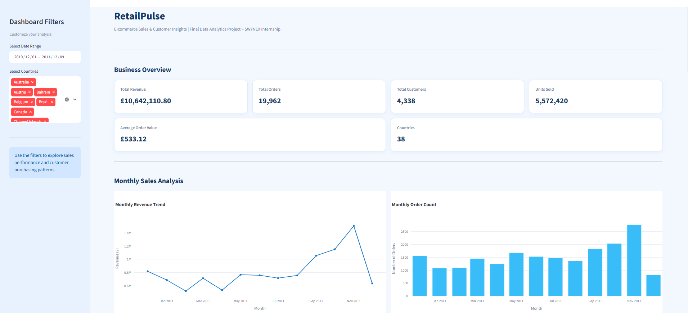
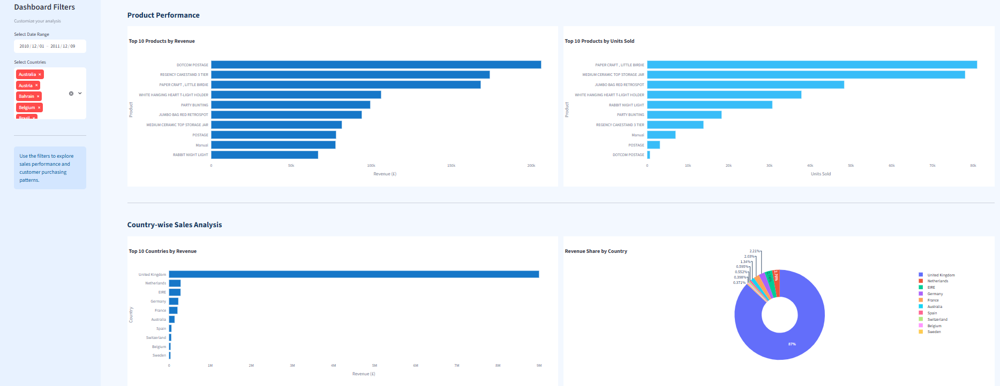
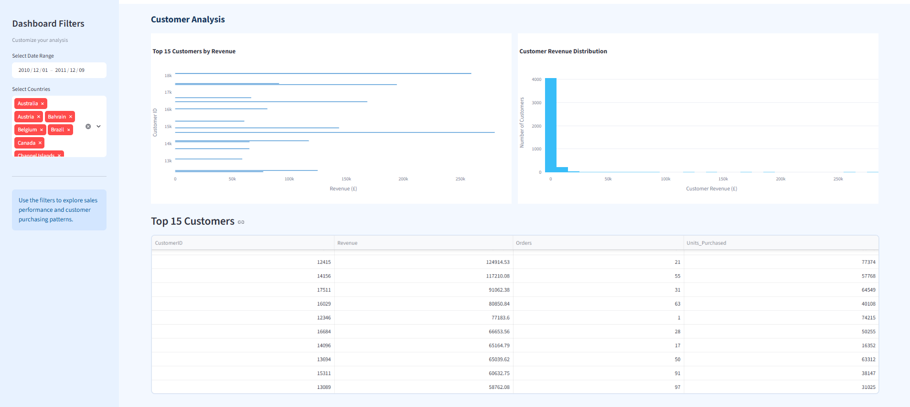
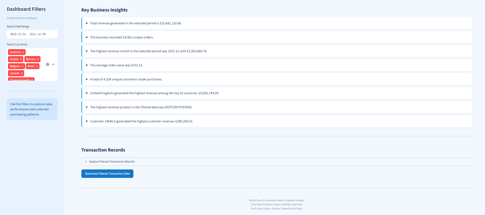

# SWYNEX Task 4 – RetailPulse: E-commerce Sales & Customer Insights

A complete data analytics case study using Python, Pandas, Plotly and Streamlit to analyze e-commerce sales, product performance, country-wise revenue and customer purchasing behaviour.

## Project Objective

Analyze online retail transactions to understand revenue trends, product performance, country-wise sales and customer purchasing behaviour. Transform raw transaction data into meaningful business insights through data cleaning, exploratory data analysis and an interactive dashboard.

## Dataset

This project uses the **UCI Online Retail Dataset (2010–2011)**, containing invoice, product, quantity, date, price, customer and country information.

- **Official Source:** https://archive.ics.uci.edu/dataset/352/online+retail
- The dataset is downloaded from the official UCI repository using the included downloader.
- The original workbook is not bundled in this repository.

## Technologies Used

- Python
- Pandas
- NumPy
- Matplotlib
- Seaborn
- Plotly
- Streamlit
- VS Code

## Project Folder Structure

```text
SWYNEX_Task4/
├── data/
│   └── Online Retail.xlsx
├── dashboard/
│   └── app.py
├── notebooks/
├── outputs/
│   ├── cleaned_online_retail.csv
│   └── summary files and charts
├── src/
│   └── retailpulse.py
├── screenshots/
│   ├── dashboard-overview.png
│   ├── monthly-sales-analysis.png
│   ├── product-and-country-analysis.png
│   └── customer-analysis-and-business-insights.png
├── download_dataset.py
├── run_analysis.py
├── requirements.txt
└── README.md
```

## Setup and Installation (Windows PowerShell)

Run the following commands from the project folder:

**1. Create a virtual environment**

```powershell
py -m venv .venv
```

**2. Activate the virtual environment**

```powershell
.\.venv\Scripts\Activate.ps1
```

If PowerShell blocks activation, run:

```powershell
Set-ExecutionPolicy -Scope Process -ExecutionPolicy Bypass
```

Then activate the environment again.

**3. Install dependencies**

```powershell
python -m pip install -r requirements.txt
```

**4. Download the dataset**

```powershell
python download_dataset.py
```

**5. Run the data analysis**

```powershell
python run_analysis.py
```

**6. Launch the interactive dashboard**

```powershell
streamlit run dashboard/app.py
```

## Project Workflow

1. **Data Collection:** Download the Online Retail dataset from the UCI repository.
2. **Data Cleaning:** Remove duplicate records, cancelled invoices, missing values and invalid transactions.
3. **Exploratory Data Analysis:** Analyze sales trends, product performance, country-wise revenue and customer purchasing patterns.
4. **Data Visualization:** Create charts to understand important patterns and trends.
5. **Interactive Dashboard:** Develop a Streamlit dashboard with date and country filters, key performance indicators and interactive visualizations.
6. **Business Insights:** Identify important findings from the analyzed data.

## Data Cleaning Rules

- Remove duplicate transaction rows.
- Exclude cancelled invoices (invoice numbers beginning with `C`).
- Remove rows with missing required information.
- Keep only positive quantities and positive unit prices.
- Convert invoice dates into the appropriate date format.
- Calculate revenue using:

  `Revenue = Quantity × UnitPrice`

- Perform customer-level analysis using records with a known CustomerID.

## Key Business Questions

- How does revenue change month by month?
- Which products generate the highest revenue?
- Which countries contribute the most sales?
- What are the order and customer trends?
- Which customers contribute the most revenue?
- What business insights can be identified from the transaction data?

## Dashboard Screenshots

### 1. Dashboard Overview



### 2. Monthly Sales Analysis



### 3. Product and Country Analysis



### 4. Customer Analysis and Business Insights



## Key Analysis Results

The analysis is based on the downloaded UCI Online Retail dataset. The cleaning and analysis scripts generate the cleaned transaction data, summary tables and visualizations in the `outputs/` folder.

## Important Note

Run the dataset downloader and analysis script before launching the dashboard. The dashboard uses the generated cleaned dataset when available.

## Author

**Priyada Mangaonkar**

Computer Engineering Student

- **GitHub:** https://github.com/mangaonkarpriyada-code
- **LinkedIn:** https://www.linkedin.com/in/priyada-mangaonkar-906b42424/

---

**Project:** RetailPulse – E-commerce Sales & Customer Insights  
**Internship:** SWYNEX Technologies – Data Analyst Internship  
**Task:** Task 4 – Final Data Analytics Project